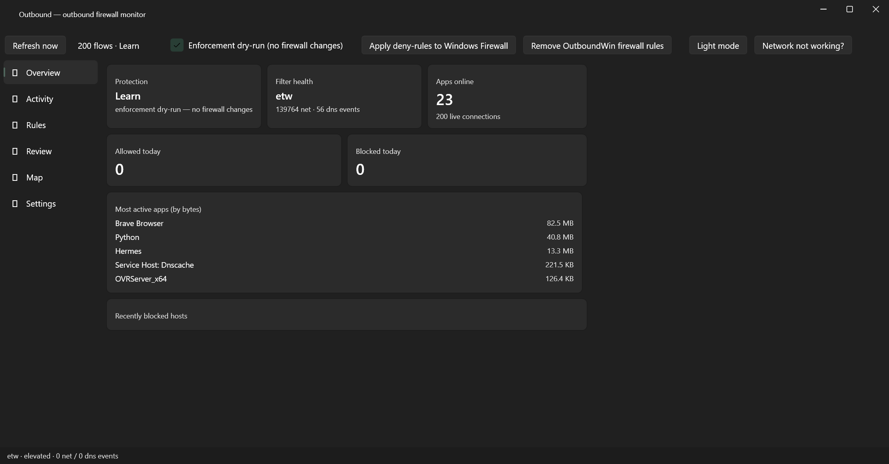
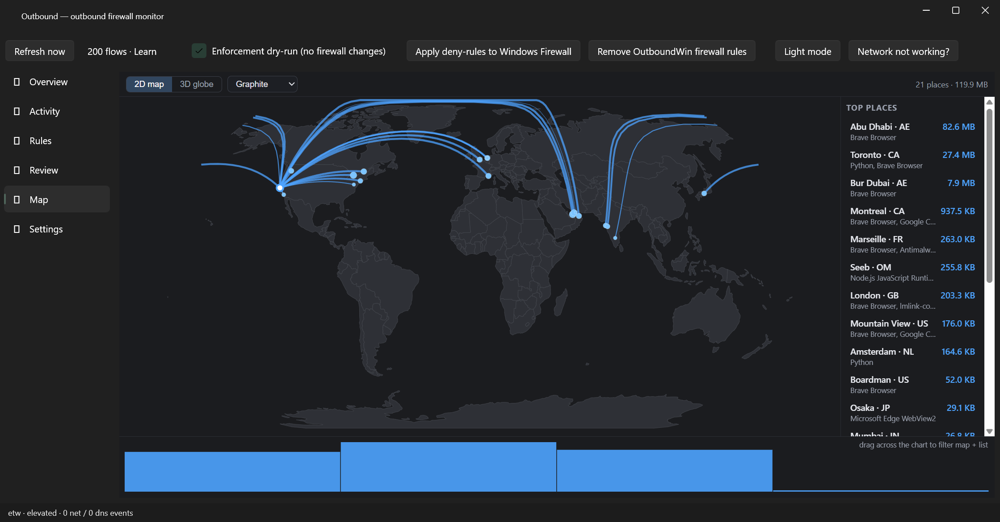
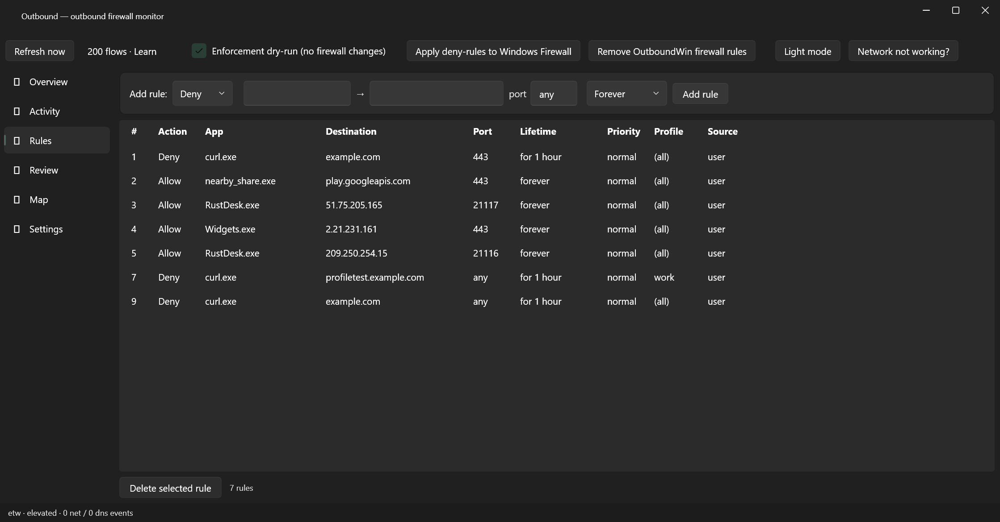
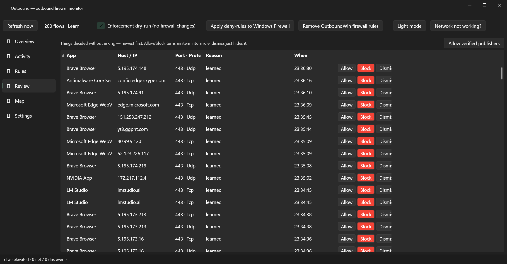
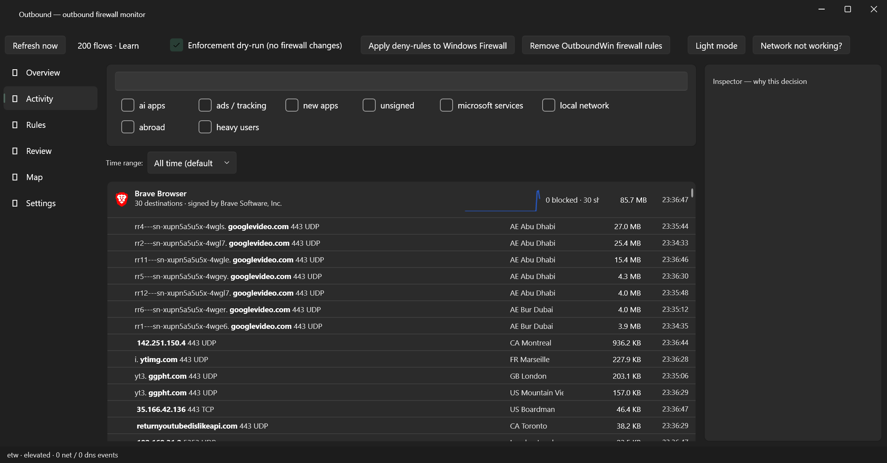
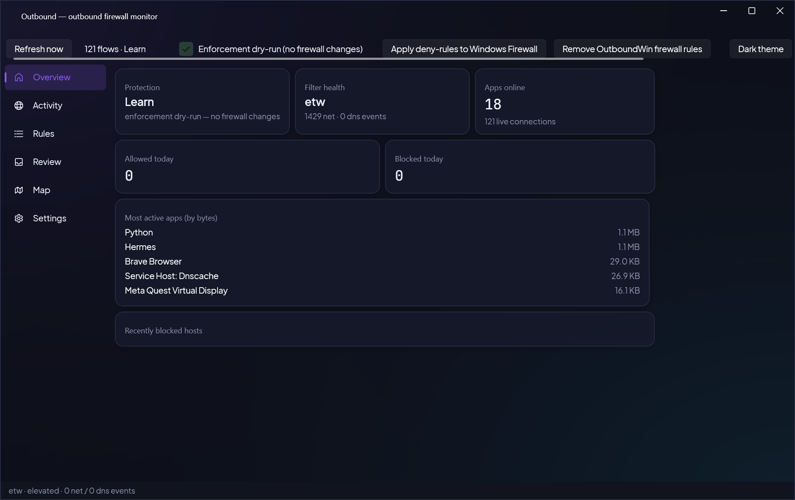
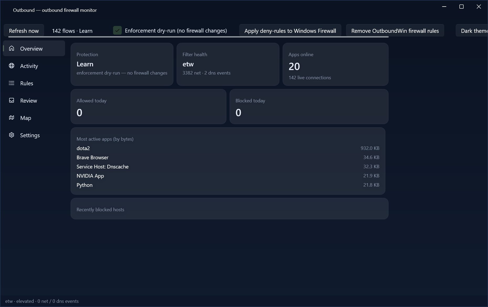
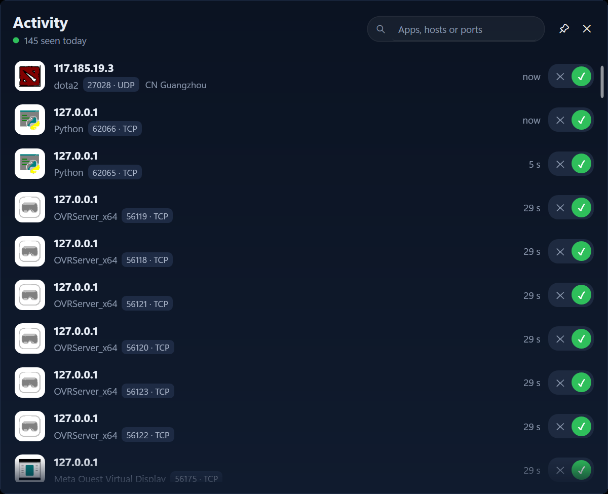
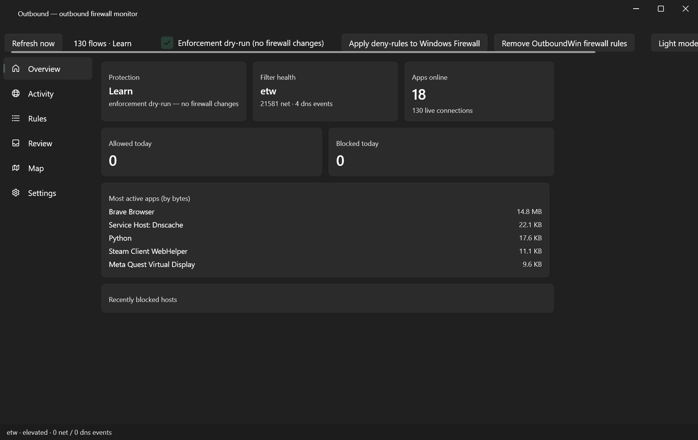

# OutGate: Windows Outbound Firewall Monitor

**See every outbound connection on your Windows PC, per app, with destination, bytes and country, and decide what's allowed to talk to the internet. Free, open source, fully offline.**

[](LICENSE)




OutGate is a per-app outbound network monitor and application firewall for Windows 10 and 11. It shows which programs are connecting out, where they're going, how much data they send and receive, and which country the remote end is in. You can mark each app as Allow, Ask, or Block, and optionally enforce those decisions as real Windows Firewall rules. It has no telemetry, needs no account, and the map and geolocation work without an internet connection.

## Contents

- [Why OutGate?](#why-outgate)
- [Features](#features)
- [Screenshots](#screenshots)
- [How it works](#how-it-works)
- [Requirements](#requirements)
- [Build from source](#build-from-source)
- [GeoIP database (optional)](#geoip-database-optional)
- [Command line: outboundctl](#command-line-outboundctl)
- [MCP server for AI tools](#mcp-server-for-ai-tools)
- [Data and privacy](#data-and-privacy)
- [FAQ](#faq)
- [Project layout](#project-layout)
- [Contributing](#contributing)
- [License](#license)

## Why OutGate?

Windows Firewall is good at blocking inbound traffic, but it tells you almost nothing about what your own apps send out. You can't easily answer simple questions like "what is this updater talking to?" or "which app just sent 200 MB to another country?"

The tools that do answer those questions usually install kernel drivers, sniff packets, are closed source, or need a cloud account. I wanted something lighter: a monitor that uses what Windows already provides, keeps everything on the machine, and lets me move from watching to blocking only when I'm ready.

## Features

- **Live per-app connection monitor:** destination IP and host, sent/received bytes, and the country of each remote IP
- **Offline world map, 2D and 3D,** of where your apps connect, drawn from bundled NASA Blue Marble / Natural Earth imagery with no map tiles
- **Allow / Ask / Block decisions** per app, per publisher (code signer), or per exact executable path
- **Review queue** for new apps, so nothing gets a decision without you seeing it
- **Optional Windows Firewall enforcement.** Dry-run by default, so it's safe to try. It never changes the default outbound policy.
- **Pause and "Network not working?" recovery,** a one-click 15-minute pause for when a rule breaks connectivity
- **System tray app** with a flyout for status, mode switching and today's numbers
- **Five themes:** System, Light, Dark, Midnight and Aurora, with bundled open-licensed (OFL) fonts
- **`outboundctl` CLI and an MCP server,** so scripts and AI tools can query live connections and manage rules

## Screenshots

| | |
|---|---|
|  |  |
| World map of outbound destinations | Rules page |
|  |  |
| Review queue for new apps | Activity feed |
|  |  |
| Aurora theme | Midnight theme |
|  |  |
| Compact activity view | App icons |

## How it works

- **Capture:** OutGate reads connection and DNS events from real-time kernel **ETW (Event Tracing for Windows)** sessions. It installs no driver, does no packet capture, and adds no network tap. It only uses the telemetry Windows already produces.

- **Identity:** each connection is tied to its process, executable path and code-signing publisher. That's what makes per-app and per-publisher rules possible.
- **Geolocation:** remote IPs are looked up in a local DB-IP City Lite `.mmdb` file, with no lookup service involved.
- **Enforcement (optional):** your decisions can be written out as Windows Firewall rules at the WFP level. Until you turn this on, OutGate only monitors and reports what it *would* do.

## Requirements

- Windows 10 or 11, x64
- [.NET 8 SDK](https://dotnet.microsoft.com/download/dotnet/8.0) to build
- Administrator rights at runtime (see the [FAQ](#faq))
- WebView2 Runtime for the map page (preinstalled on Windows 10/11)

## Build from source

```powershell
git clone https://github.com/symshah/outgate.git
cd outgate
dotnet build Outbound.sln
```

Then run `src\Outbound.App\bin\Debug\net8.0-windows\Outbound.exe` as administrator.

For a release build:

```powershell
dotnet publish src/Outbound.App -c Release -r win-x64 --self-contained false
```

To run the unit tests:

```powershell
dotnet test tests/Outbound.Tests/Outbound.Tests.csproj
```

## GeoIP database (optional)

The city-level database is about 122 MB, so it isn't committed to the repo. To enable country lookups:

1. Download the free **DB-IP IP to City Lite** database (`.mmdb` format, CC BY 4.0) from [db-ip.com](https://db-ip.com/db/download/ip-to-city-lite). The free Lite edition is all you need.
2. Save it as `assets/geoip/dbip-city-lite.mmdb`.

Without it, OutGate builds and runs normally, and foreign IPs just show `?` for country.

## Command line: outboundctl

`outboundctl` talks to the running app over a local named pipe that only the current user can access. It returns the same figures you see in the UI.

```powershell
outboundctl status                               # mode, flow and rule counts, uptime
outboundctl rules list                           # same view as the Rules page
outboundctl rules add --deny --app telemetry.exe --dest example.com --kind domain
outboundctl explain --app chrome.exe --host example.com --port 443
outboundctl export --jsonl > rules.jsonl         # back up all rules
outboundctl flows --json                         # current connections (no app needed)
```

`explain` shows the decision, the rule that made it, and every other rule that matched, which helps a lot when debugging an unexpected block. Run `outboundctl` with no arguments to see the full command list.

## MCP server for AI tools

OutGate includes an MCP server (`outbound-mcp`) so AI assistants can query live connections and manage rules. It runs over stdio. To start it from any MCP client, run:

```json
{
  "mcpServers": {

    "outgate": { "command": "C:\\path\\to\\outboundctl.exe", "args": ["mcp"] }
  }
}
```

The CLI also has `rules propose`, which waits for you to approve or deny the rule in the app before anything is added. That keeps you in control when a tool suggests a change.

## Data and privacy

Everything stays on your machine:

- Rules: `%LOCALAPPDATA%\OutboundWin\rules.db`
- Settings: `%LOCALAPPDATA%\OutboundWin\settings.json`
- Logs: `%LOCALAPPDATA%\OutboundWin\`

There's no telemetry, no account and no phone-home.

## FAQ

**Why does it need administrator rights?**
On Windows, real-time kernel ETW sessions and firewall rule management are both admin-only. Without elevation, OutGate can't see connections or write rules.

**What happens without the GeoIP database?**
Everything still works. Connections, bytes, rules and the map all function, and foreign countries show as `?`.

**Is this a full firewall?**
It's monitor-first. Out of the box it only watches and records decisions. Enforcement is opt-in. When enabled, it writes explicit Windows Firewall rules for the apps you block, and it never changes Windows' default outbound policy.

**I blocked something and now my network is broken.**
Use **Pause**, or **Network not working?** in the tray. That pauses OutGate for 15 minutes so you can fix the rule.

**Does it install a driver?**

No. Capture is done entirely with ETW, and enforcement uses the built-in Windows Firewall.

## Project layout

| Path | Contents |
|------|----------|
| `src/Outbound.Core` | Engine: ETW capture, rules, policy, enforcement, GeoIP |
| `src/Outbound.App` | WPF UI (Wpf.Ui), tray, map, named-pipe server |
| `src/outboundctl` | CLI client |
| `src/outbound-mcp` | MCP server |
| `tests/Outbound.Tests` | Unit tests for the core engine |
| `screens/` | Screenshots |

The internal project and namespace name is `Outbound` / `OutboundWin`. The product name is **OutGate**.

## Contributing

Issues and pull requests are welcome. Bug reports with the output of `outboundctl diag flows` or `outboundctl explain ...` are especially useful. For larger changes, please open an issue first so we can agree on the approach. Run the test suite before submitting.

If OutGate is useful to you, a star helps other people find it.

## License

[MIT](LICENSE). Free for personal and commercial use.

IP geolocation by [DB-IP](https://db-ip.com), licensed under CC BY 4.0. Map imagery from NASA Blue Marble and Natural Earth. Fonts are bundled under the SIL Open Font License.
